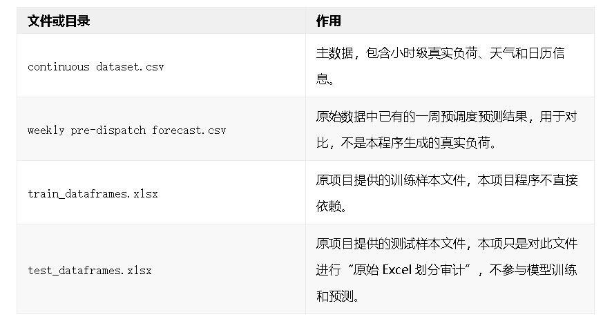
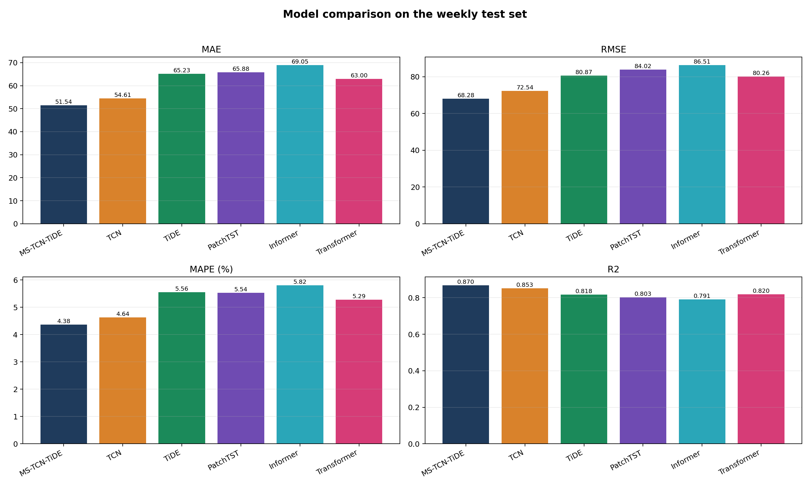
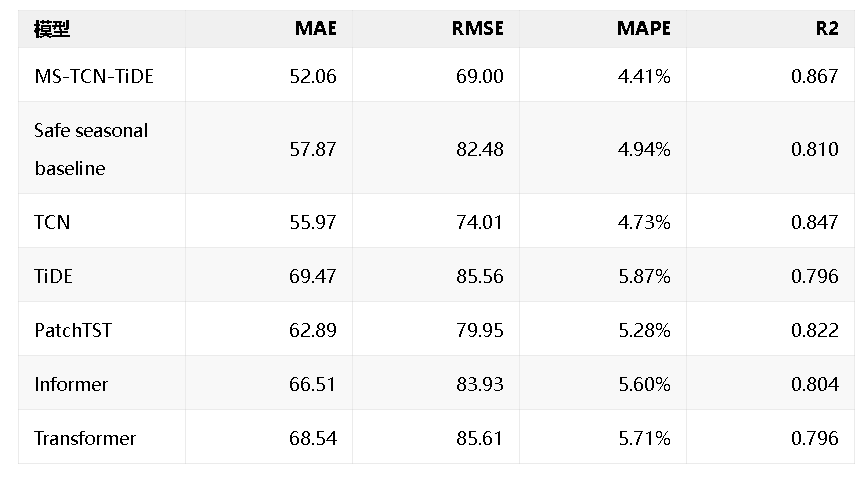
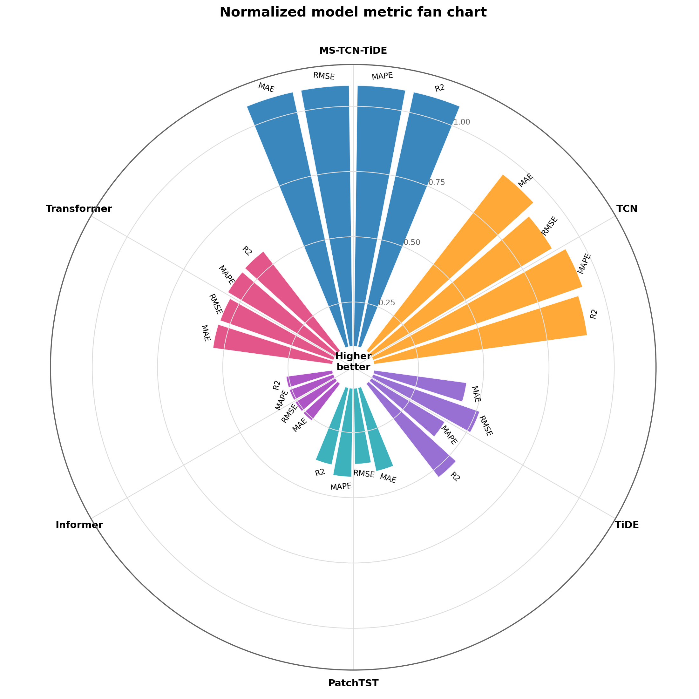
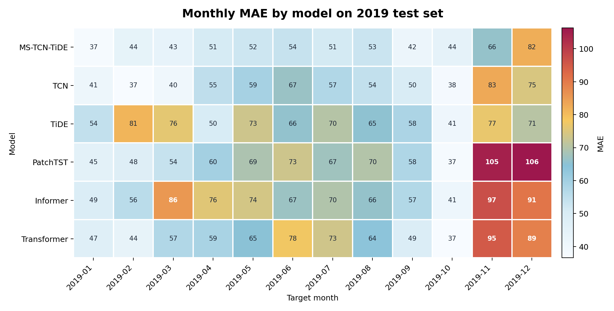
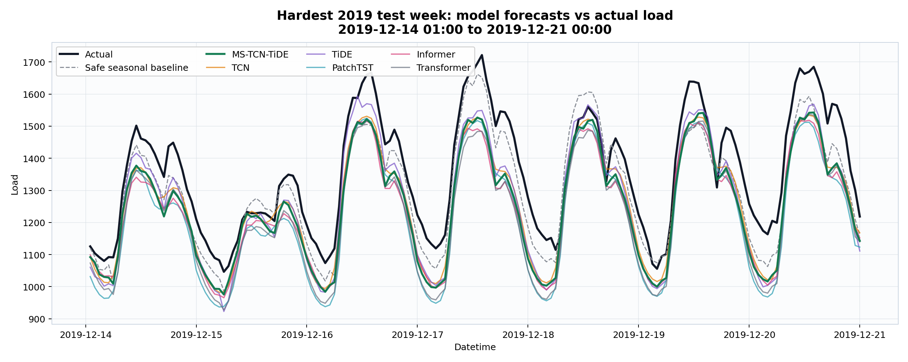
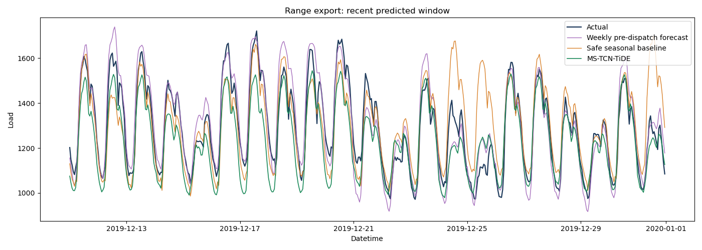
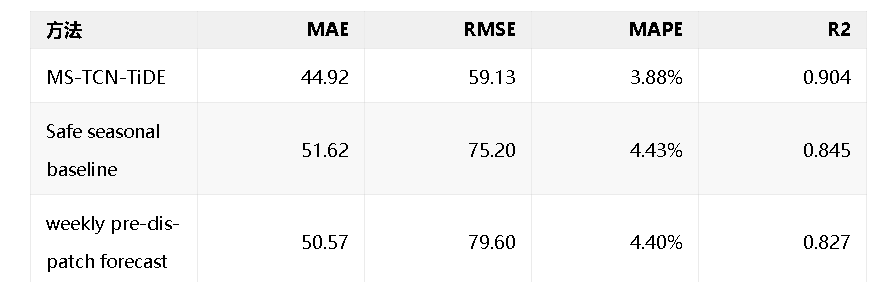
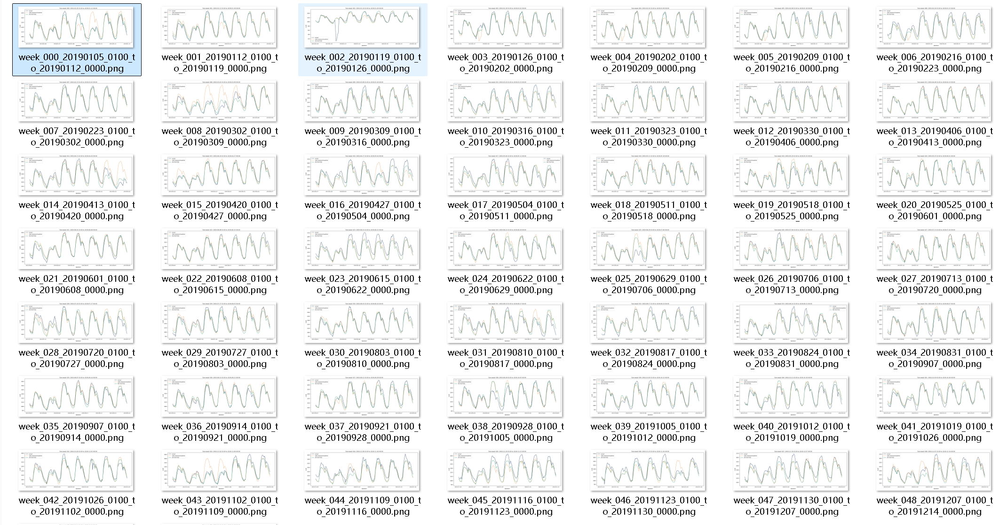
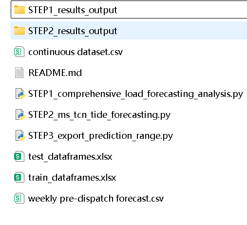

# High-Innovation Model MS-TCN-TiDE, Short-Term Load Forecasting, Python Code

This dataset is a real-time electricity load dataset, with the core file being continuous_dataset.csv. It includes actual load nat_demand, multiple meteorological station temperature/humidity/wind speed variables, as well as calendar information such as holidays, school days, and timestamps. It represents a challenging real-time load dataset. The data features long time spans, a fixed sampling frequency of 1 hour, and the load sequence has distinct daily, weekly, and seasonal variations. It is also influenced by weather and special dates, making it suitable for week-scale load forecasting modeling and comparative experiments.

The directory and introduction of this data are as follows:

File or Directory:

Project Phases:

1. Data Analysis: This phase involves data inspection, including load, weather, temporal characteristics, missing values, and existing prediction results, and saving the results to STEP1_results_output.
2. Model Training: This phase involves reconstructing unbiased samples from continuous_dataset.csv, defaulting to training using data from 2015-2017, validation in 2018, and testing in 2019, while excluding data from 2020.
3. Model Loading: This phase involves loading the trained MS-TCN-TiDE model and outputting hourly load predictions within a specified time range.

The project's core data comes from continuous_dataset.csv, which includes hourly real load nat_demand, weather variables, and calendar variables; weekly_predispatch_forecast.csv contains the original week-ahead pre-dispatch forecast results, only used for comparative analysis and not involved in model training. During data processing, the program constructs time cycle characteristics, holiday/school day characteristics, and weather statistical and derived features such as temperature, humidity, and wind speed, and completes standardization based on the training set.
Samples are constructed based on a "weekly prediction window": each sample uses the last available historical load and related features, and after an advance of 73 hours, it directly predicts the load for the next 168 hours. The historical inputs include the last 336 hours, daily cycle, weekly cycle, and low-frequency trend information; the future inputs default to calendar features that can be known in advance, thus closer to the real pre-scheduling prediction scenario.
The innovative model is MS-TCN-TiDE. Its advantage lies in considering short-term continuous changes, daily cycle, weekly cycle, and low-frequency trends simultaneously, and outputting the results for the next 168 hours directly with multi-step forecasting, avoiding the error accumulation step by step in rolling forecasts.
In terms of model construction, MS-TCN-TiDE can be understood as a structure of "multi-scale historical encoding + future information decoding". The first half uses multiple TCN branches to learn the recent continuous load, hourly daily cycle, weekday hour cycle, and low-frequency weekly trend respectively, compressing the load changes at different time scales into a unified historical state; the second half draws on the direct multi-step prediction idea of TiDE, integrating the historical state with the calendar covariates for the next week, outputting the load prediction for 168 hours points in one go. Finally, the program will also perform an overall bias correction according to the validation set error, used to correct the systematic offset of the model at numerical level.
To determine whether the innovative model is truly effective, the program also includes several common time series deep learning baselines, including TCN, TiDE, PatchTST, Informer, and Transformer. These models use the same data split, the same prediction window, and the same evaluation metrics, so their results can be directly compared.
This project is well-suited for continued refinement into a paper due to its comprehensive research loop: it includes clear application scenarios for power load forecasting, rigorous data audits and leak-free sample construction, an innovative model for weekly pre-scheduling tasks, as well as multiple deep learning baseline models and visualization results. Compared to training only one model, this project is easier to form narratives for papers: it can revolve around data construction, direct multi-step prediction, multi-scale historical modeling, future calendar covariate fusion, and cross-model comparison experiments.
The results section of the tweet is where the most suitable content for highlighting should be presented. It is recommended to present the results in the order of "overall metrics comparison, comprehensive score graph, month stability, difficult sample prediction curve, long-range prediction comparison". This way, readers can gradually understand the model's performance from the overall to the specific details.
Figure 1: Model metric comparison bar chart
This figure shows the MAE, RMSE, MSE, and R2 of each model on the test set in 2019. It is evident that MS-TCN-TiDE outperforms current comparative models in all four main indicators: MAE at 52.06, MSE at 4.41%, and R2 at 0.97.
Current test set main indicators are as follows:

Figure 2: Model metric radar chart
This chart normalizes different indicators to the same direction: the farther away from the center, the better. Compared to looking at tables alone, it is more suitable for quickly showcasing the comprehensive performance of models. MS-TCN-TiDE stands out in terms of total area on the radar chart, indicating that it does not just lead in one indicator but maintains a good balance between error and fitting degree across various metrics.
Figure 3: Monthly MAE heatmap
Load forecasting should not only focus on the annual average error but also examine whether the model is stable across different months. The monthly heatmap shows that in November and December of 2019, most models had high errors, indicating that predicting load changes during this period is more challenging and may be related to seasonal variations, temperature fluctuations, or changes in electricity usage patterns.
Comparative analysis from the horizontal perspective reveals that MS-TCN-TiDE maintained lower errors across most months, especially when compared with models like TiDE, Informer, and Transformer. This suggests that integrating multi-scale historical information and future calendar covariates can help with cross-month predictions.
Figure 4: Most Difficult Test Week Prediction Overlay
This graph selects the prediction with the highest error among the test set by MS-TCN-TiDE, superimposing the actual load, reference cycle baseline, and multiple model prediction curves. Compared to average metrics, this graph better showcases the model's performance on challenging samples.
It is evident that all models captured the clear daily cycle fluctuations within a week, but there were varying degrees of deviation at peak loads. MS-TCN-TiDE's curve generally followed the trend well, stably aligning with cycle changes; however, this graph also truthfully highlights the shortcomings of the model: it still has room for improvement when facing extreme peaks or rapid changes.
Figure 5: Range Prediction Comparison from 2016 to 2019
For the 2019 test set, the project also exported continuous range predictions from 2016 to 2019 and compared them with the original data's weekly pre-dispatch forecast.csv. This result provides a closer view of "long-term continuous use of the model," rather than just focusing on a single test slice.
In the 2016-2019 comparison, MS-TCN-TiDE's MAE is 44.92 and MAPE is 3.88%, while the MAE for weekly pre-dispatch forecast is 50.57 and MAPE is 4.40%. This indicates that the current model not only performs effectively on the test set but also maintains good error levels over a longer time range.

Figure 6: The program predicts all cycles
The program has made predictions for the entire year of 2019, with each prediction lasting 168 hours of load, allowing for precise observation of the prediction effects at different times.

In summary, this project completed a relatively complete power load prediction process: firstly, data analysis was conducted, then a strict and leak-free time window was constructed, followed by training of innovative models and multiple baseline models, and finally outputting prediction tables, indicator tables, and visualization charts.
From the results, MS-TCN-TiDE outperformed several comparative models on the test set in 2019, and it also significantly outperformed the existing weekly pre-dispatch forecast.csv in the continuous range prediction from 2016 to 2019. This demonstrates the practical value of multi-scale historical modeling, future calendar information integration, and direct multi-step forecasting for week-scale load prediction.
Code directory screenshots are as follows:

Steps have been divided between each other to make it easier to understand the program.

## Images

<!-- PAYMENT_BLOCK -->

## Get this dataset

- Payment link (Stripe): [Buy now](https://buy.stripe.com/3cs8yP7sY87d0vu9AB)
- Payment QR code: 

<!-- /PAYMENT_BLOCK -->
